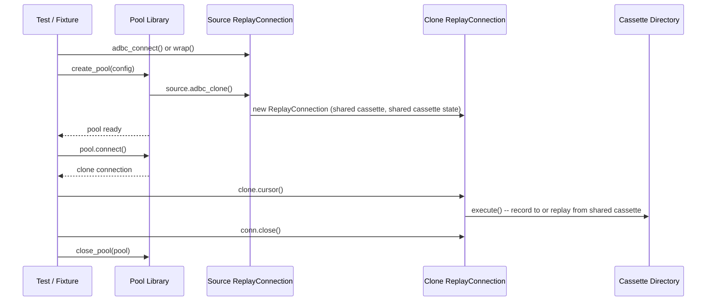

# Connection pooling and replay

This article explains how pytest-adbc-replay handles connection pooling, why a test's connections share one cassette and one record/replay state, and what happens when connections run queries concurrently.

## Why clones share the cassette path

A pool connection is logically the same database session. When a pool library calls `adbc_clone()` on a source connection, each checkout is a handle to the same underlying database. All queries from any checkout belong to the same test and should be recorded in the same cassette directory.

If each clone had a separate cassette path, the cassette directory structure would fragment unpredictably based on how many pool connections were checked out. A test that checks out two connections would produce two cassette directories; running the same test with a different pool size would produce a different number. The cassette layout would depend on pool configuration rather than test identity, making replay unreliable.

Sharing the cassette path keeps things simple: one test, one cassette directory, regardless of how many pool connections are used.

## Pool replay lifecycle

The following diagram shows the lifecycle of a pool-based test from source connection through to disposal:

In **record mode**, the real ADBC connection is also cloned via `self._real_conn.adbc_clone()`. Each clone holds its own real connection handle and executes queries against the live database. Results are written to the shared cassette directory.

In **replay mode**, clones have no real connection (`_real_conn = None`). Cursors replay from the shared cassette directory without any database access.

## One cassette state per test

A cassette is a record of what a test did, not of what one connection did. So the decisions about a cassette are made once per test and shared by every cursor, clone and connection the test opens on it. That includes separate `connect()` calls, which is how a pool that opens a connection per query behaves, and connections opened by a fixture's teardown.

The shared state covers four things:

- **The `once` decision.** At the test's first query, the plugin checks whether the cassette already holds interactions. If it doesn't, every query the test runs is recorded. If it does, every query is replayed. Deciding per query would not work: the test's own first recording would make the cassette look recorded, and its second query would replay and miss.
- **The `all` wipe.** The cassette directory is deleted once, at the test's first query. A later pool checkout doesn't delete recordings made by an earlier one.
- **Interaction numbering.** Each recording takes the next free number in the cassette directory, so two cursors never write over each other's files.
- **The replay queue.** The cassette is loaded once into a queue per query (normalised SQL plus parameters), and every connection takes results from it. A query the test repeats on new connections, such as a count before and after an insert, replays each recording in the order it was recorded.

The state is released when the test ends, so the next test, or a rerun of the same one, decides afresh. A connection created with `wrap()` without a `request` isn't tied to a test, so it gets state of its own.

## Concurrent access

Cursors update the shared state under a lock, so concurrent cursors never write the same interaction number and never receive the same recording. Results are matched to queries by SQL and parameters, so a thread running one query never receives another query's result.

One case still depends on thread scheduling: when several threads run the *same* query at the same time and its recordings differ, which thread receives which recording depends on who gets there first. In typical single-threaded pytest runs, queries run one after another and this never comes up.

## ADBC spec context

`adbc_clone()` is an ADBC extension, not part of the DBAPI 2.0 standard. In the ADBC Python API, calling `connection.adbc_clone()` creates a new `Connection` sharing the same underlying `AdbcDatabase`. The clone has its own transaction state and cursor lifecycle but shares the database handle.

pytest-adbc-replay's `ReplayConnection.adbc_clone()` follows this pattern: the clone shares configuration, cassette path and cassette state with its source, and has its own cursors.

See the [ADBC Python API documentation](https://arrow.apache.org/adbc/current/python/api/adbc_driver_manager.html) for the upstream specification.

---

- [Use with connection pools](../how-to/connection-pools.md) -- how-to guide with pool fixture patterns
- [Connection Pooling reference](../reference/connection-pooling.md) -- `adbc_clone()` method spec and shared cassette semantics
